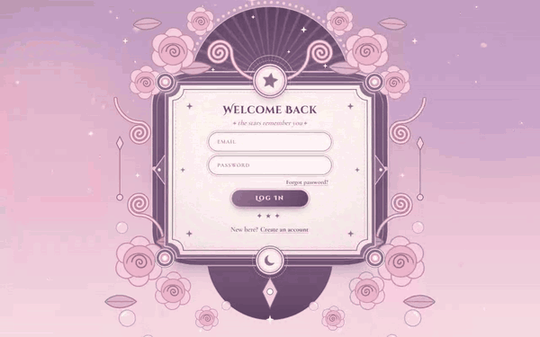
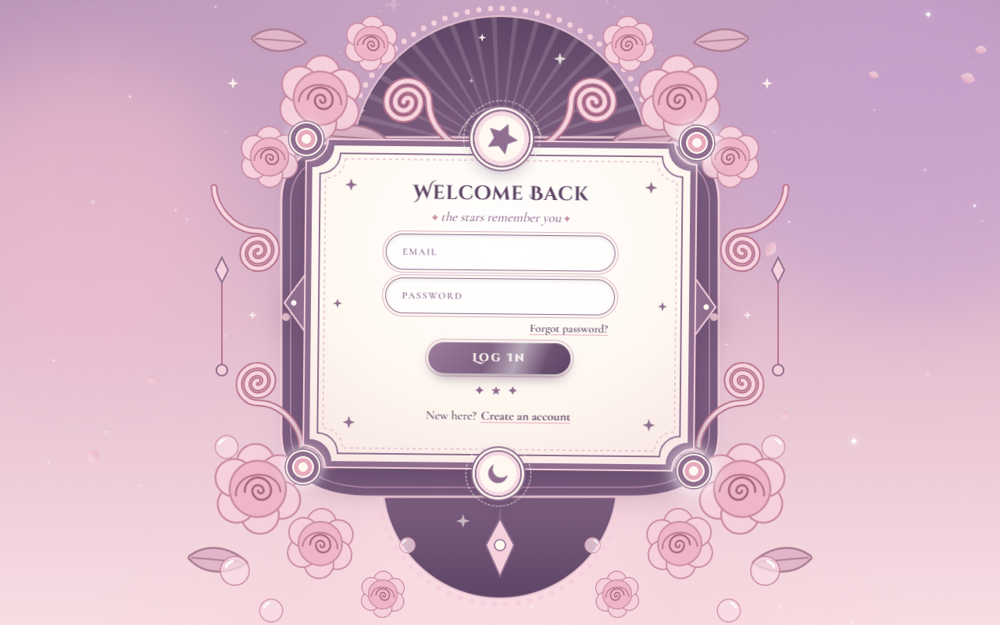
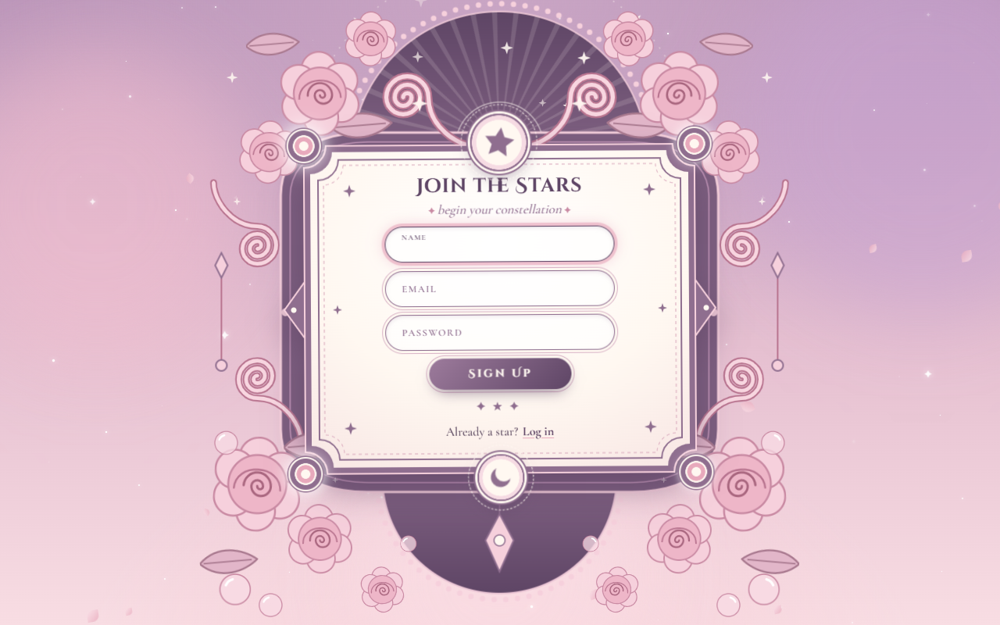
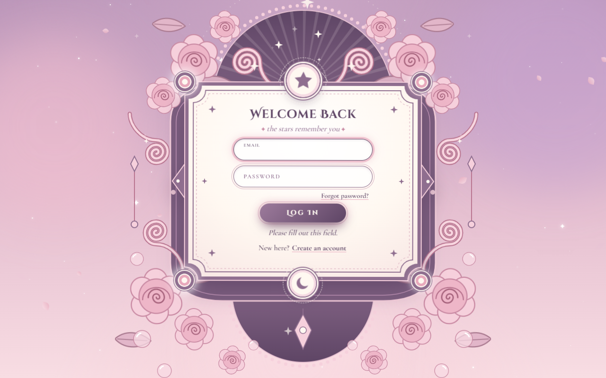

# ✦ Starlight Login UI

An animated, storybook-style login and sign-up card. It flips in 3D between the two forms, sits inside an SVG frame of peonies, and is surrounded by twinkling stars, falling petals and sparkle bursts.

It is a **single `index.html` file** with no build step, no framework and no dependencies (just Google Fonts).

**[▶ Live demo](https://abrinera.github.io/starlight-login-ui/)**

## Screenshots

| Log in | Sign up |
|---|---|
|  |  |

| Inline validation |
|---|
|  |

## Features

- **3D card flip.** Login ⇄ sign-up spins the card 540° on the Y axis, with a scale/Z-depth "swoop", a 720° orbit spin and two sparkle bursts.
- **Pointer parallax.** On desktop the card tilts toward the mouse, the ornament layer shifts the other way, and the cursor leaves a sparkle trail.
- **Ambient scene.** 80 twinkling stars, 18 falling petals, drifting blurred blobs, shooting stars, a rotating star orbit and swaying peonies.
- **Floating-label inputs.** Pill-shaped fields whose labels float up on focus or when filled.
- **Validation.** Uses the browser's built-in constraint validation (`required`, `type="email"`, `minlength="6"`). An invalid field shakes, gets focus, and its message appears in a live status region.
- **Fits any screen.** The whole 760×820 illustration is scaled with one CSS variable, so the card always fits the viewport.
- **Accessible.** Uses semantic sections and labels, `role="status"` messages, and `inert` on the hidden face so you can't tab into it. It also has visible focus rings, a screen-reader-only `<h1>`, and full support for `prefers-reduced-motion`.

## Tech details

| | |
|---|---|
| **Stack** | HTML5, CSS3, vanilla JavaScript (ES2020+). No libraries. |
| **Fonts** | [Cinzel Decorative](https://fonts.google.com/specimen/Cinzel+Decorative) (headings, button), [Cormorant Garamond](https://fonts.google.com/specimen/Cormorant+Garamond) (body) |
| **Graphics** | Inline SVG: reusable `<symbol>`s (`#rose`, `#leaf`, `#bubble`, `#sparkle`, `#frame`), gradients and a `clipPath`. No image files. |
| **Animation** | CSS `@keyframes` for ambient loops, plus the Web Animations API (`element.animate`) for one-off effects like the flip swoop and bursts |
| **Size** | ~31 KB, one file |

### Color palette

| Token | Hex | Use |
|---|---|---|
| `--cream` | `#fff8f1` | Card panel, highlights |
| `--blush` | `#f6dbe3` | Medallion rings |
| `--rose` | `#e8a9bc` | Petals, focus glow |
| `--rose-d` | `#c98aa3` | Accents, link hover |
| `--mauve` | `#8f6e8f` | Frame, borders, labels |
| `--plum` | `#5e4565` | Headings, button |
| `--ink` | `#4a3650` | Body text |
